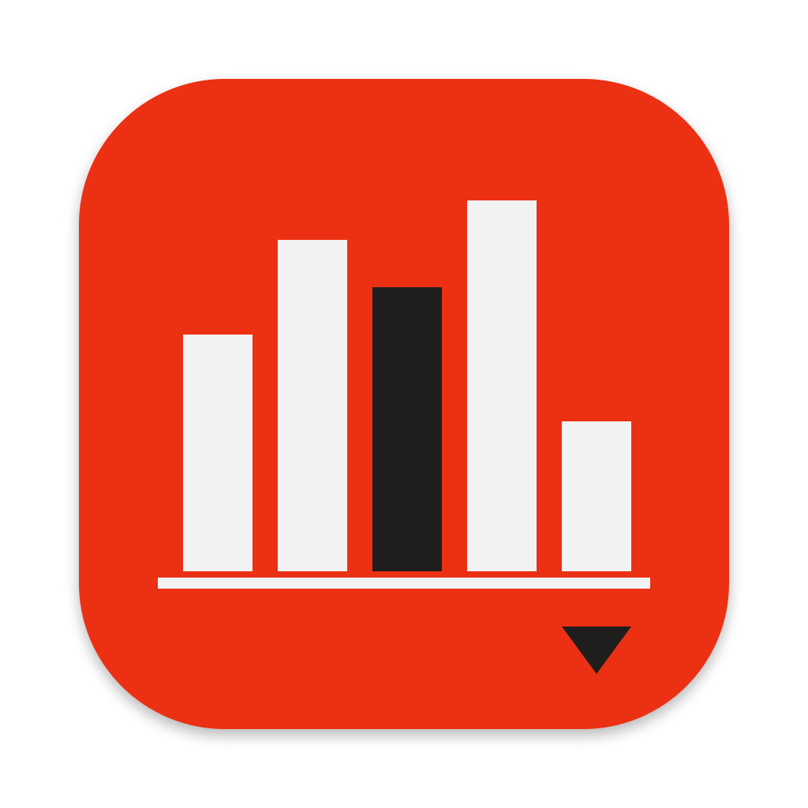

<h1 align="center">Spese ricorrenti</h1>

Tutte le spese fisse, le rate e gli abbonamenti in un colpo d'occhio, con la proiezione sui prossimi mesi · macOS 13 o successivo 
All your fixed costs, instalments and subscriptions at a glance, with a forecast for the months ahead · macOS 13 or later

<a href="https://github.com/alecensi82/SpeseRicorrenti/releases/latest/download/Spese-ricorrenti.dmg"><b>⬇︎ Scarica Spese ricorrenti / Download Spese ricorrenti</b></a>

<a href="CHANGELOG.md">Novità di ogni versione / What's new in each version</a>

---

## Italiano

Spese ricorrenti ti dà una visuale chiara e precisa di tutto quello che spendi ogni mese: abbonamenti, rate, finanziamenti, bollette e pagamenti annuali. E guarda avanti: con la proiezione sui prossimi mesi capisci quanto spenderai e quando le uscite caleranno.

- **Panoramica del mese**: addebiti reali, media mensile (bimestrali e annuali ripartiti), debito residuo di rate e finanziamenti.
- **Grafico dei prossimi 12, 24 o 36 mesi**, con il dettaglio di ogni mese e cosa paghi **in più o in meno** rispetto al mese prima, con il motivo (una rata che finisce, un pagamento annuale…).
- **Calendario degli addebiti**: in quale giorno pagherai cosa, e i prossimi addebiti in ordine di data.
- **Rate e pagamenti a rate** di qualsiasi spesa, anche annuale (es. il bollo in 3 rate PayPal), senza contarla due volte.
- **Metodi di pagamento** (PayPal, Klarna, Amazon, carta, conto…) per vedere tutto quello che paghi con ognuno.
- **Ambito, priorità e classifiche**: a cosa servono le spese, cosa è essenziale e cosa disdire.
- **Rispetto al tuo stipendio** (facoltativo): quanto pesa ogni categoria, in percentuale e in parole semplici.
- **Risparmi** con versamenti, prelievi, saldo preciso al giorno e qualche battuta nerd.
- **Storico** di aggiunte e modifiche, **stampa / PDF**, tema chiaro o scuro.
- I dati si salvano in un file nella tua cartella **iCloud Drive › Spese ricorrenti**, con backup automatici giornalieri. Nessun account, nessun server, nessuna statistica.

### Installazione
1. Scarica **Spese-ricorrenti.dmg** dalla pagina [Releases](../../releases/latest).
2. Aprilo e trascina **Spese ricorrenti** in **Applicazioni**.

L'app è firmata con Developer ID e notarizzata da Apple: si apre senza avvisi.

### iPhone
La versione per iPhone, che usa lo stesso file in iCloud Drive, è in arrivo su TestFlight.

### Licenza
Spese ricorrenti è gratuito per uso personale. Non è consentito ridistribuirlo o modificarlo. Vedi [LICENSE.txt](LICENSE.txt).

---

## English

Spese ricorrenti ("Recurring expenses") gives you a clear and precise view of everything you spend each month: subscriptions, instalments, loans, bills and yearly payments. And it looks ahead: the forecast for the coming months shows how much you will spend and when your outgoings will drop.

- **Month overview**: actual charges, monthly average (bimonthly and yearly payments spread out), remaining debt on instalments and loans.
- **Chart of the next 12, 24 or 36 months**, with each month's detail and what you pay **more or less** than the month before, with the reason.
- **Charge calendar**: which day you will pay what, plus upcoming charges in date order.
- **Instalments** for any expense, even yearly ones (e.g. a yearly tax paid in 3 PayPal instalments), never counted twice.
- **Payment methods** (PayPal, Klarna, Amazon, card, bank account…) to see everything you pay with each one.
- **Purpose, priority and rankings**: what your expenses are for, what is essential and what to cancel.
- **Compared with your salary** (optional): how much each category weighs.
- **Savings** with deposits, withdrawals and a day-accurate balance.
- **History** of additions and changes, **print / PDF**, light or dark theme.
- Your data is saved in a file in your **iCloud Drive › Spese ricorrenti** folder, with daily automatic backups. No account, no server, no tracking.

The interface is in Italian.

### Installation
1. Download **Spese-ricorrenti.dmg** from the [Releases](../../releases/latest) page.
2. Open it and drag **Spese ricorrenti** into **Applications**.

The app is signed with Developer ID and notarised by Apple, so it opens without warnings.

### Licence
Spese ricorrenti is free for personal use. Redistribution and modification are not permitted. See [LICENSE.txt](LICENSE.txt).

---

© 2026 Alessandro Censi · [www.alessandrocensi.it](https://www.alessandrocensi.it)
